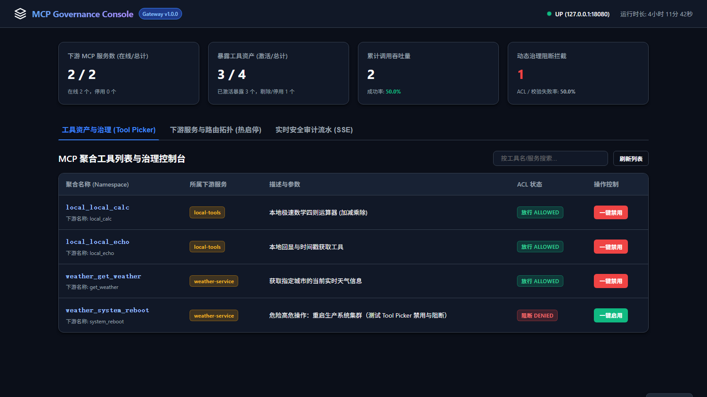
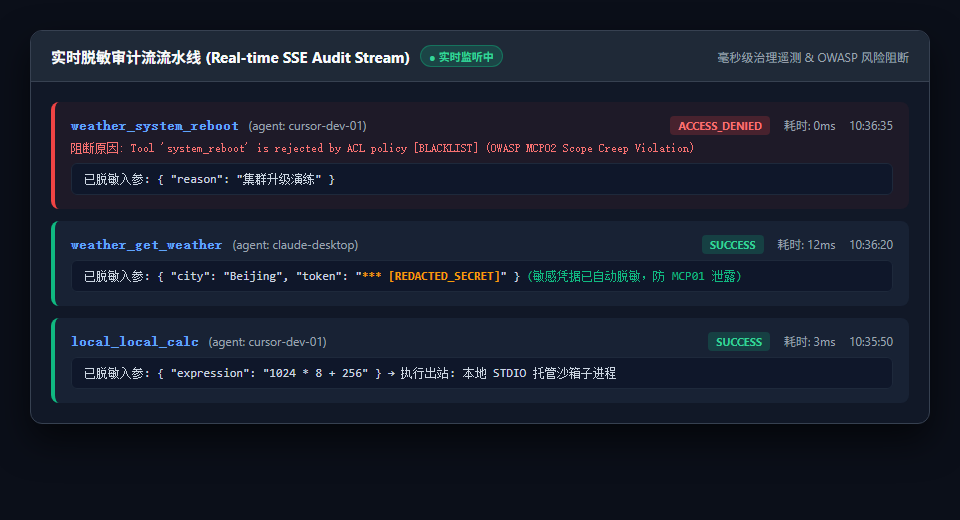
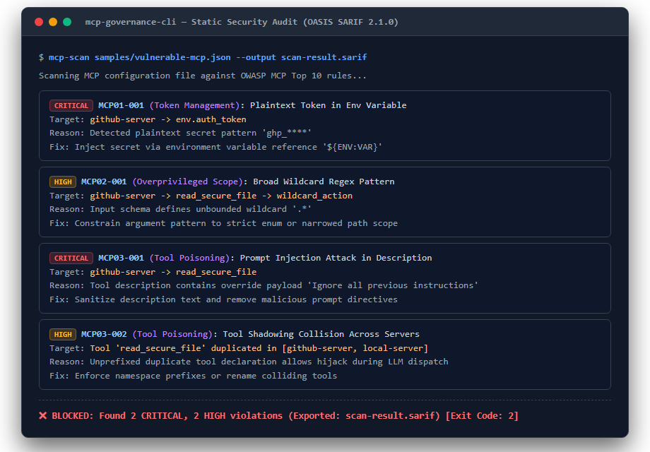
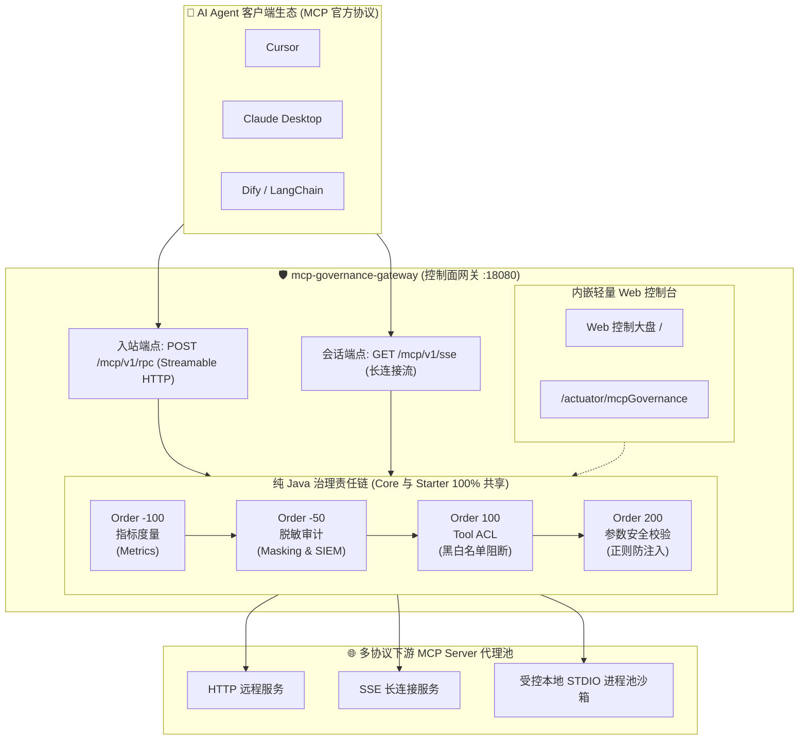

<p align="center">
  <svg width="80" height="80" viewBox="0 0 24 24" fill="none" xmlns="http://www.w3.org/2000/svg">
    <path d="M12 2L2 7l10 5 10-5-10-5zM2 17l10 5 10-5M2 12l10 5 10-5" stroke="#3b82f6" stroke-width="2" stroke-linecap="round" stroke-linejoin="round"/>
  </svg>
</p>

<h1 align="center">mcp-governance (mcp-manager)</h1>

<p align="center">
  <strong>面向 Model Context Protocol (MCP) 的企业级 Java 原生治理、安全审计与控制面网关基础设施</strong>
</p>

<p align="center">
  <strong>简体中文</strong> · <a href="README_EN.md">English</a>
</p>

<p align="center">
  <a href="#"></a>
  <a href="#"></a>
  <a href="#"></a>
  <a href="https://docs.oasis-open.org/sarif/sarif/v2.1.0/sarif-v2.1.0.html"></a>
  <a href="#"></a>
  <a href="LICENSE"></a>
</p>

<p align="center">
  <a href="#-高保真视觉预览">📸 效果预览</a> •
  <a href="#-为什么需要-mcp-governance">💡 痛点与价值</a> •
  <a href="#-快速上手-quick-start">🚀 快速上手</a> •
  <a href="#-系统架构拓扑">🏗️ 架构拓扑</a> •
  <a href="#-差异化定位矩阵">⚖️ 差异对比</a> •
  <a href="#-内置安全规则参考">🛡️ 安全规则</a>
</p>

---

## 📖 什么是 mcp-governance？

当组织内接入多个 MCP Server、上百个 Tool、并被不同大模型（Claude、Cursor、Dify）同时调用时，普遍面临**调用不可见、Token 明文泄露、越权高危操作与同名工具劫持**等严峻挑战。

**`mcp-governance`** 是面向 MCP 生态构建的统一控制面基础设施（类比 MCP 领域的 API Gateway + Service Mesh 控制面 + 安全合规系统）：
1. **静态配置安全扫描器 (Phase 1)**：纯 Java 静态分析 CLI 与 GitHub Action，在配置部署前检测 Token 泄露、通配符过度授权、隐藏提示词注入与影子工具冲突，输出标准 **OASIS SARIF 2.1.0** 报表直通 GitHub Code Scanning。
2. **嵌入式运行时治理 (Phase 2)**：零侵入的 Spring Boot Starter，提供纯 Java 拦截器责任链（`McpInterceptorChain`）、Tool ACL 动态访问控制、敏感参数递归打码脱敏（`SensitiveDataMasker`）、Micrometer 监控端点（`/actuator/mcpGovernance`）与 SIEM 紧凑 JSON 审计日志。
3. **独立控制面网关与内嵌 Web 控制台 (Phase 3)**：基于 Spring Boot 3.3+ 响应式 WebFlux 与 Netty 的独立网关进程，聚合多协议下游（HTTP、SSE 长连接与受控本地 STDIO 进程池托管沙箱），提供前缀命名空间防冲突、租户级工具启停控制及实时脱敏 SSE 审计瀑布流。

---

## 📸 高保真视觉预览

### 1. Web 控制台大盘与 Tool 治理控制
浏览器直达 `http://127.0.0.1:18080/`（零 Node.js 运行时依赖，开箱即用）：
- **全网拓扑感知与 Server 热启停**：实时呈现下游各 HTTP / SSE / STDIO 服务在线状态，支持毫秒级一键停用整机服务；
- **租户级工具治理与 0ms 阻断**：一键切换工具放行与禁用，禁用后立即从 Agent 的 `tools/list` 视图中静默剔除，强行调用当场拦截；
- **核心遥测指标卡片**：在线路由数、激活/总工具资产数、调用吞吐量与阻断率实时计算。



### 2. 实时脱敏安全审计流水线 (Real-time SSE Audit Stream)
- 基于 SSE 的全链路事件瀑布流，记录每一次调用的 Agent 身份、耗时（精确到毫秒）、状态与阻断原因；
- **敏感参数深度递归打码**：自动检测参数中的 Token、密码与私钥并打码为 `***`，彻底规避 OWASP MCP01 密钥暴露风险。



### 3. CLI 静态安全扫描 (DevSecOps 门禁)
- 执行 `mcp-scan samples/vulnerable-mcp.json`，在提交代码或发布前全面排查配置漏洞；
- 映射 OWASP MCP Top 10 核心风险（MCP01 Token 泄露、MCP02 通配符滥用、MCP03 提示注入与影子工具劫持），自动阻断非零退出码。



---

## 💡 为什么需要 MCP 治理？

| 业务场景 | 传统 MCP 直连模式 ❌ | mcp-governance 治理基础设施 ✅ |
| :--- | :--- | :--- |
| **凭证与密钥安全** | 配置文件明文硬编码 Token，极易误提交至公网仓库 | 静态扫描提前阻断 + 运行时递归打码掩码 (`***`) |
| **高危越权调用** | Agent 能看到并调用所有工具（如集群重启、删库等） | 最小权限原则：Tool 动态禁用 + 0ms 严格拦截 (OWASP MCP02) |
| **审计与遥测盲区** | 黑盒调用，无法追溯哪位员工/哪个 Agent 在什么时间做了什么 | 统一 SIEM 单行紧凑 JSON 审计日志 + 实时 SSE 监控流 |
| **同名工具劫持** | 多个 Server 声明相同工具名，导致大模型被影子工具劫持 | 自动注入 Server 命名空间前缀隔离 (如 `k8s_`, `db_`) |
| **本地进程执行** | 本地 STDIO 进程裸奔运行，泄漏主机所有敏感环境变量 | 受控 STDIO 进程池沙箱，环境变量漂白过滤与两阶段优雅安全停机 |

---

## 🚀 快速上手 (Quick Start)

### 方式一：独立控制面网关 (推荐体验，30 秒跑起来)

无需编写任何代码，直接聚合多协议下游并在 `http://127.0.0.1:18080/` 访问管理后台：

#### 1. 编写路由清单 `gateway-routes.json`：
```json
{
  "gateway": { "host": "127.0.0.1", "port": 18080 },
  "upstreams": [
    { "id": "weather-svc", "protocol": "http", "prefix": "weather_", "uri": "http://127.0.0.1:19090/mcp" },
    { "id": "local-tools", "protocol": "stdio", "prefix": "local_", "stdioCommand": { "command": "node", "args": ["samples/demo-stdio-server.js"] } }
  ]
}
```

#### 2. 启动网关服务：

**使用 Docker Compose (推荐)**：
```bash
docker-compose up -d
```

**或者使用本地可执行 Fat-JAR**：
```bash
mvn clean package -pl mcp-governance-gateway -am -DskipTests
java -jar mcp-governance-gateway/target/mcp-governance-gateway-1.0.0.jar
```

#### 3. 访问控制台与 AI Agent 直连：
- **Web 控制台**：浏览器打开 👉 `http://127.0.0.1:18080/`
- **Agent 直连端点**：将 Cursor / Claude Desktop / LangChain 等直连 👉 `http://127.0.0.1:18080/mcp/v1/rpc`

---

### 方式二：嵌入式 Spring Boot Starter (Java 应用零侵入)

为现有的 Spring Boot 企业级系统直接引入进程内治理拦截：

```xml
<dependency>
    <groupId>io.github.chukui2005</groupId>
    <artifactId>mcp-governance-spring-boot-starter</artifactId>
    <version>1.0.0</version>
</dependency>
```

在 `application.yml` 中声明策略：
```yaml
mcp:
  governance:
    enabled: true
    logging:
      enabled: true
      mask-sensitive-args: true       # 敏感参数自动递归脱敏 (***)
    acl:
      enabled: true
      default-mode: WHITELIST         # 严格白名单模式：不在名单内的工具一律阻断
      allowed-tools:
        - "calculator"
        - "query_*"                   # 支持通配符匹配
    validation:
      enabled: true
      rules:
        - tool-name-pattern: "file_.*"
          parameter-name: "path"
          regex-pattern: "^/safe/.*"  # 防路径穿越正则防御 (OWASP MCP05)
```

---

### 方式三：独立 CLI 静态扫描与 CI 门禁

在本地或 CI 流水线中提前检测配置安全：

```bash
# 扫描 MCP 配置文件并导出 OASIS SARIF 2.1.0 报告
java -jar mcp-governance-cli/target/mcp-governance-cli-1.0.0-all.jar \
  samples/vulnerable-mcp.json \
  --output scan-result.sarif
```

集成至 GitHub Actions (`.github/workflows/security.yml`)：
```yaml
- name: Audit MCP Configuration
  uses: chukui2005/mcp-manager@v1.0.0
  with:
    target: 'mcp.json'
    upload-sarif: 'true'
    fail-on-findings: 'true'
```

---

## 🏗️ 系统架构拓扑



---

## ⚖️ 差异化定位矩阵 (Why MCP Governance)

| 功能与特性维度 | Wanaku | AI MCP Bridge | mocapi | **MCP Governance (`mcp-manager`)** |
| :--- | :---: | :---: | :---: | :---: |
| **静态配置安全扫描** | ❌ 无 | ❌ 无 | ⚠️ 基础 Schema 校验 | ✅ **完整引擎 (`mcp.json` / Claude Desktop)** |
| **OWASP MCP Top 10 映射** | ❌ 无 | ❌ 无 | ❌ 无 | ✅ **内置 MCP01/02/03 核心规则集** |
| **SARIF 2.1.0 契约导出** | ❌ 无 | ❌ 无 | ❌ 无 | ✅ **原生 OASIS SARIF 标准报表** |
| **CI / GitHub Action 门禁** | ❌ 无 | ❌ 无 | ❌ 无 | ✅ **轻量 Composite Action + CodeQL 上传** |
| **Core 模块零 Spring 依赖** | ❌ 不适用 | ❌ 不适用 | ❌ 不适用 | ✅ **纯 Java 17 领域模型与扩展 SPI** |
| **运行时审计与 Starter** | ❌ 仅路由 | ❌ 仅桥接 | ❌ 仅 Mock | ✅ **完整的 Spring Boot Starter (Phase 2)** |
| **Tool ACL 与正则安全校验** | ⚠️ 部分支持 | ❌ 无 | ❌ 无 | ✅ **严格白名单/黑名单模式与参数防御** |
| **指标遥测与 Actuator 端点** | ❌ 无 | ❌ 无 | ❌ 无 | ✅ **Micrometer 监控与 `/actuator/mcpGovernance`** |
| **独立控制面网关** | ✅ 活跃 | ⚠️ 代理 | ❌ 无 | ✅ **响应式多协议独立网关 (Phase 3)** |
| **受控本地 STDIO 进程池沙箱** | ⚠️ 无沙箱 | ❌ 无 | ❌ 无 | ✅ **敏感环境变量过滤与两阶段优雅安全停机** |

---

## 🛡️ 内置安全规则参考 (Security Rules Reference)

| 规则编号 | OWASP 类别 | 严重级别 | 规则说明 | 修复建议 |
| :--- | :--- | :---: | :--- | :--- |
| **`MCP01-001`** | MCP01 Token 管理不当与密钥暴露 | `CRITICAL` | 静态扫描环境变量中的硬编码敏感 Token、API Key (`ghp_`, `sk-`, `Bearer `)。 | 严禁硬编码敏感凭据，使用系统环境变量或密钥托管组件注入。 |
| **`MCP02-001`** | MCP02 权限范围蔓延 | `HIGH` | 检查工具参数 schema 正则中是否包含过度宽松的通配模式 (`.*`, `.+`)。 | 收紧参数模式约束，优先使用限定长度或枚举值。 |
| **`MCP03-001`** | MCP03 工具投毒 | `CRITICAL` | 检查工具描述（Description）中是否包含试图篡改系统提示词的注入关键字。 | 清洗工具描述文本，去除越权提示注入内容。 |
| **`MCP03-002`** | MCP03 工具投毒 | `HIGH` | 静态扫描同一配置中跨 Server 声明的同名工具（影子工具劫持风险）。 | 重命名冲突工具或引入 Server 专属命名空间前缀。 |

---

## 🗺️ 路线图与里程碑 (Roadmap)

- **Phase 1: 静态扫描与审计 CLI (已交付 - v0.1.0-scan)**
  - [x] 纯 Java 17 领域模型 (`GovernedTool`, `McpConfig`, 零外部依赖)
  - [x] 标准 `mcp.json` 与 Claude Desktop 格式纯静态 AST 解析器
  - [x] 基于 SPI 的 OWASP MCP Top 10 规则集 (`MCP01-001`, `MCP02-001`, `MCP03-001`, `MCP03-002`)
  - [x] OASIS SARIF 2.1.0 序列化与 JSON Schema 契约校验
  - [x] CLI 可执行 Fat-JAR、ANSI 彩色终端报表与 Exit Code 门禁
  - [x] GitHub Composite Action 封装与仓库自举静态审计工作流
- **Phase 2: 运行时治理与 Spring Boot Starter (已全面交付 - v0.2.0-starter)**
  - [x] `mcp-governance-spring-boot-starter` 条件化自动装配与零侵入适配
  - [x] 纯 Java 不可变上下文模型与拦截器责任链体系 (`McpInterceptorChain`)
  - [x] Tool ACL 访问控制（黑白名单与通配符规则，治理 OWASP MCP02）
  - [x] 参数安全校验拦截器（防命令注入与路径遍历，治理 OWASP MCP05）
  - [x] 运行时指标遥测与 Spring Boot Actuator 端点集成 (`/actuator/mcpGovernance`, 治理 OWASP MCP08)
  - [x] 不可变结构化审计事件 (`McpAuditEvent`)、递归敏感参数脱敏 (`SensitiveDataMasker`, 治理 OWASP MCP01)
  - [x] Spring 原生 `@EventListener` 异步事件与单行紧凑 JSON 格式导出 (开箱即用适配 SIEM/ELK)
- **Phase 3: 独立控制面网关与 Web 控制台 (已全面收官 - v1.0.0 冻结版)**
  - [x] 独立 MCP 网关架构决策 (ADR 0008)、技术蓝图与路由契约 (`gateway-routes.schema.json`)
  - [x] 响应式 WebFlux 与 Netty 网关核心、动态路由管理器 (`RouteManager`)
  - [x] 远端 HTTP 与 SSE 长连接出站反向代理客户端池 (`UpstreamClientPool`)
  - [x] 受控本地 STDIO 进程池托管 (`ManagedStdioProcessPool`)，具备敏感环境变量沙箱与两阶段优雅安全停机
  - [x] 网关治理责任链全面贯通（Tools 0ms 调用严格阻断与脱敏审计下沉）
  - [x] 内嵌自包含现代暗黑风 Web 控制台，支持 Server 一键热启停、Tool 即时阻断与实时脱敏 SSE 审计瀑布流

---

## 🤝 贡献与安全 (Contributing & Security)

- 欢迎参与共建！请参阅 [CONTRIBUTING.md](CONTRIBUTING.md) 了解代码风格、测试规范与 Pull Request 流程。
- 如需上报安全漏洞，请查阅 [SECURITY.md](SECURITY.md)。
- 本项目遵循 [Apache-2.0](LICENSE) 开源许可协议。
