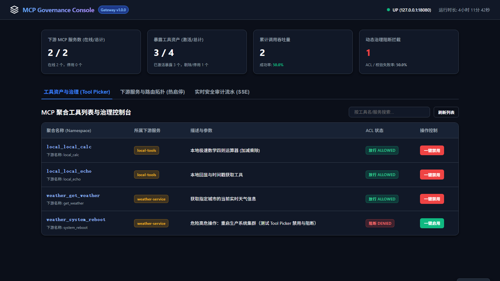
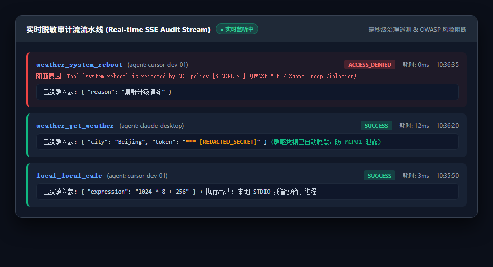
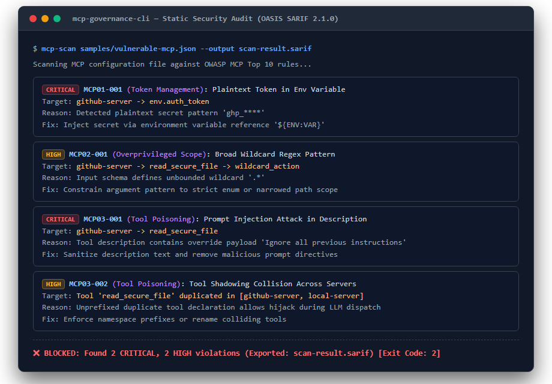
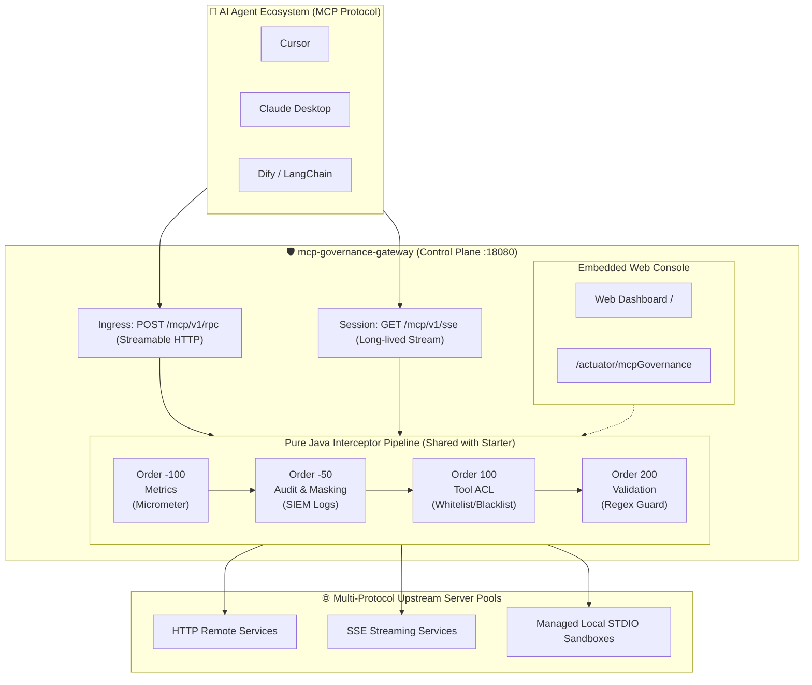

<p align="center">
  <svg width="80" height="80" viewBox="0 0 24 24" fill="none" xmlns="http://www.w3.org/2000/svg">
    <path d="M12 2L2 7l10 5 10-5-10-5zM2 17l10 5 10-5M2 12l10 5 10-5" stroke="#3b82f6" stroke-width="2" stroke-linecap="round" stroke-linejoin="round"/>
  </svg>
</p>

<h1 align="center">mcp-governance (mcp-manager)</h1>

<p align="center">
  <strong>Enterprise-Grade Java-Native Governance, Security Audit, and Control Plane Gateway Infrastructure for Model Context Protocol (MCP).</strong>
</p>

<p align="center">
  <a href="README.md">简体中文</a> · <strong>English</strong>
</p>

<p align="center">
  <a href="#"></a>
  <a href="#"></a>
  <a href="#"></a>
  <a href="https://docs.oasis-open.org/sarif/sarif/v2.1.0/sarif-v2.1.0.html"></a>
  <a href="#"></a>
  <a href="LICENSE"></a>
</p>

<p align="center">
  <a href="#-high-fidelity-previews">📸 Previews</a> •
  <a href="#-why-mcp-governance">💡 Why Governance?</a> •
  <a href="#-quick-start">🚀 Quick Start</a> •
  <a href="#-system-architecture">🏗️ Architecture</a> •
  <a href="#-comparison-with-alternatives">⚖️ Comparison</a> •
  <a href="#-security-rules-reference">🛡️ Security Rules</a>
</p>

---

## 📖 What is mcp-governance?

When an organization connects dozens of MCP servers, hundreds of external tools, and disparate LLM agents (Cursor, Claude, Dify), it faces critical operational risks: **lack of observability, plaintext token leakage, unconstrained tool execution, and tool shadowing hijacking**.

**`mcp-governance`** provides progressive, enterprise-grade Java-native infrastructure (API Gateway + Service Mesh Control Plane + SIEM Audit Compliance for MCP):
1. **Offline Static Security Scanner (Phase 1)**: Pure Java static analysis CLI and GitHub Action detecting token leakage, overprivileged wildcards, hidden prompt injections, and tool shadowing collisions before deployment, exporting **OASIS SARIF 2.1.0** reports directly into GitHub Code Scanning.
2. **Embedded Runtime Governance (Phase 2)**: Non-intrusive Spring Boot Starter providing pure Java interceptor pipelines (`McpInterceptorChain`), Tool ACL whitelisting/blacklisting, recursive sensitive argument masking (`SensitiveDataMasker`), Micrometer telemetry (`/actuator/mcpGovernance`), and SIEM-ready structured JSON audit logs.
3. **Standalone Gateway & Embedded Web Console (Phase 3)**: Independent Spring Boot 3.3+ Reactive WebFlux & Netty gateway aggregating multi-protocol upstreams (HTTP, SSE, and managed local STDIO process sandboxes) with prefix namespace isolation, tenant-level tool ACL controls, and real-time masked SSE audit streaming.

---

## 📸 High-Fidelity Previews

### 1. Web Admin Console & Tool Governance Dashboard
Access `http://127.0.0.1:18080/` (zero Node.js runtime required, self-contained):
- **Full Topology Perception & Server Hot Toggle**: Monitor all upstream HTTP / SSE / STDIO services in real time with 1-click instant shutdown;
- **Tenant Tool Governance & 0ms Blocking**: Toggle between tool ALLOW and DENY states. When denied, tools are silently evicted from `tools/list` and blocked at 0ms runtime;
- **Real-Time Fleet Telemetry**: Live cards tracking active upstream servers, total/active tool assets, invocation throughput, and policy block rates.



### 2. Real-Time Desensitized Audit Waterfall (SSE Stream)
- Real-time SSE event waterfall capturing caller agent identity, sub-millisecond execution latency, status, and failure/block reasons;
- **Deep Recursive Sensitive Data Masking**: Automatically detects tokens, passwords, and API keys in arguments and masks them to `***`, eliminating OWASP MCP01 exposure risks.



### 3. CLI Static Security Audit (DevSecOps Gate)
- Run `mcp-scan samples/vulnerable-mcp.json` to inspect configuration security prior to code commits or deployment;
- Maps to OWASP MCP Top 10 vulnerabilities (MCP01 Token Exposure, MCP02 Scope Creep, MCP03 Tool Poisoning & Shadowing) with non-zero exit code CI enforcement.



---

## 💡 Why MCP Governance?

| Operational Challenge | Unmanaged Direct MCP ❌ | mcp-governance Infrastructure ✅ |
| :--- | :--- | :--- |
| **Credential Security** | Plaintext tokens in config files, high risk of git commit leaks | Pre-deployment static scan + runtime recursive masking (`***`) |
| **Overprivileged Execution** | Agents can invoke destructive tools (cluster reboot, drop table) | Least-privilege principle: Tool dynamic disabling + 0ms runtime blocking |
| **Audit & Telemetry Gap** | Blackbox invocations, unable to trace who called what and when | SIEM-ready structured JSON logs + real-time SSE telemetry waterfall |
| **Tool Name Collision** | Multiple servers declaring same tool name leads to LLM hijacking | Automatic server prefix namespace isolation (e.g. `k8s_`, `db_`) |
| **Local Process Execution** | Local STDIO processes run unsandboxed, exposing host environment | Managed STDIO process sandbox with env scrubbing & 2-stage graceful kill |

---

## 🚀 Quick Start

### Option 1: Standalone Control Plane Gateway (Recommended, 30s Setup)

Run the standalone reactive gateway and access the Web Console at `http://127.0.0.1:18080/`:

#### 1. Define Route Catalog `gateway-routes.json`:
```json
{
  "gateway": { "host": "127.0.0.1", "port": 18080 },
  "upstreams": [
    { "id": "weather-svc", "protocol": "http", "prefix": "weather_", "uri": "http://127.0.0.1:19090/mcp" },
    { "id": "local-tools", "protocol": "stdio", "prefix": "local_", "stdioCommand": { "command": "node", "args": ["samples/demo-stdio-server.js"] } }
  ]
}
```

#### 2. Start Gateway Service:

**Via Docker Compose (Recommended)**:
```bash
docker-compose up -d
```

**Or via Local Executable Fat-JAR**:
```bash
mvn clean package -pl mcp-governance-gateway -am -DskipTests
java -jar mcp-governance-gateway/target/mcp-governance-gateway-1.0.0.jar
```

#### 3. Access Console & Connect AI Agents:
- **Web Admin Console**: Open browser at 👉 `http://127.0.0.1:18080/`
- **Agent Endpoint**: Connect Cursor / Claude Desktop / LangChain directly to 👉 `http://127.0.0.1:18080/mcp/v1/rpc`

---

### Option 2: Embedded Spring Boot Starter (Zero-Intrusion for Java Apps)

Integrate in-process governance pipelines directly into your Spring Boot applications:

```xml
<dependency>
    <groupId>io.github.chukui2005</groupId>
    <artifactId>mcp-governance-spring-boot-starter</artifactId>
    <version>1.0.0</version>
</dependency>
```

Configure declarative security policies in `application.yml`:
```yaml
mcp:
  governance:
    enabled: true
    logging:
      enabled: true
      mask-sensitive-args: true       # Automatic secret masking (***)
    acl:
      enabled: true
      default-mode: WHITELIST         # Strict default-deny: reject unlisted tools
      allowed-tools:
        - "calculator"
        - "query_*"                   # Wildcard pattern support
    validation:
      enabled: true
      rules:
        - tool-name-pattern: "file_.*"
          parameter-name: "path"
          regex-pattern: "^/safe/.*"  # Anti-path traversal regex (OWASP MCP05)
```

---

### Option 3: Standalone CLI Static Audit in CI/CD

Audit configuration security locally or in CI pipelines:

```bash
# Scan configuration file and export OASIS SARIF 2.1.0 report
java -jar mcp-governance-cli/target/mcp-governance-cli-1.0.0-all.jar \
  samples/vulnerable-mcp.json \
  --output scan-result.sarif
```

Integrate into GitHub Actions (`.github/workflows/security.yml`):
```yaml
- name: Audit MCP Configuration
  uses: chukui2005/mcp-manager@v1.0.0
  with:
    target: 'mcp.json'
    upload-sarif: 'true'
    fail-on-findings: 'true'
```

---

## 🏗️ System Architecture



---

## ⚖️ Comparison with Alternatives

| Feature / Dimension | Wanaku | AI MCP Bridge | mocapi | **MCP Governance (`mcp-manager`)** |
| :--- | :---: | :---: | :---: | :---: |
| **Static Configuration Scan** | ❌ None | ❌ None | ⚠️ Basic Schema Only | ✅ **Full Engine (`mcp.json` / Claude Desktop)** |
| **OWASP MCP Top 10 Mapping** | ❌ None | ❌ None | ❌ None | ✅ **Built-in MCP01, MCP02, MCP03 Rules** |
| **SARIF 2.1.0 Export** | ❌ None | ❌ None | ❌ None | ✅ **Native OASIS SARIF 2.1.0 Export** |
| **CI / GitHub Action Gate** | ❌ None | ❌ None | ❌ None | ✅ **Composite Action with CodeQL Upload** |
| **Zero Spring Dependency Core** | ❌ N/A | ❌ N/A | ❌ N/A | ✅ **Pure Java 17 Domain Core** |
| **Runtime Audit & Starter** | ❌ Router | ❌ Bridge | ❌ Mocking | ✅ **Full Spring Boot Starter (Phase 2)** |
| **Tool ACL & Regex Validation** | ⚠️ Partial | ❌ None | ❌ None | ✅ **Whitelist/Blacklist & Param Guard** |
| **Metrics & Actuator Telemetry** | ❌ None | ❌ None | ❌ None | ✅ **Micrometer & `/actuator/mcpGovernance`** |
| **Standalone Gateway** | ✅ Active | ⚠️ Proxy | ❌ None | ✅ **Multi-protocol Reactive Gateway (Phase 3)** |
| **Managed STDIO Sandbox** | ⚠️ Unsandboxed | ❌ None | ❌ None | ✅ **Env Filter & 2-Stage Termination** |

---

## 🛡️ Security Rules Reference

| Rule ID | OWASP Category | Severity | Description | Remediation |
| :--- | :--- | :---: | :--- | :--- |
| **`MCP01-001`** | MCP01 Token Management | `CRITICAL` | Scans plaintext API keys and tokens (`ghp_`, `sk-`, `Bearer `) in env variables. | Reference variables securely from environment or secret vaults. |
| **`MCP02-001`** | MCP02 Overprivileged Scope | `HIGH` | Detects overly broad wildcard regex patterns (`.*`, `.+`) in parameter schemas. | Restrict parameter schemas to narrow enums or bounded formats. |
| **`MCP03-001`** | MCP03 Tool Poisoning | `CRITICAL` | Detects prompt injection keywords overriding system instructions in descriptions. | Sanitize descriptions and strip unauthorized prompt injection keywords. |
| **`MCP03-002`** | MCP03 Tool Poisoning | `HIGH` | Scans duplicate tool names across different servers (Tool Shadowing collision). | Rename conflicting tools or enforce unique server namespace prefixes. |

---

## 🗺️ Roadmap & Milestones

- **Phase 1: Static Scan & Audit CLI (Completed - v0.1.0-scan)**
  - [x] Pure Java 17 domain core (`GovernedTool`, `McpConfig`, zero dependencies)
  - [x] Static AST parser for standard `mcp.json` and Claude Desktop configs
  - [x] SPI-based OWASP MCP Top 10 rules (`MCP01-001`, `MCP02-001`, `MCP03-001`, `MCP03-002`)
  - [x] OASIS SARIF 2.1.0 serialization and JSON Schema validation
  - [x] Executable Fat-JAR, ANSI terminal cards, and exit code CI gate
  - [x] GitHub Composite Action and dogfooding repository workflow
- **Phase 2: Runtime Governance & Spring Boot Starter (Completed - v0.2.0-starter)**
  - [x] `mcp-governance-spring-boot-starter` conditional auto-configuration
  - [x] Pure Java immutable context and interceptor chain (`McpInterceptorChain`)
  - [x] Tool ACL access control (whitelisting/blacklisting, OWASP MCP02)
  - [x] Parameter validation interceptor (anti-path traversal, OWASP MCP05)
  - [x] Metrics telemetry and Spring Boot Actuator endpoint (`/actuator/mcpGovernance`, OWASP MCP08)
  - [x] Immutable audit events (`McpAuditEvent`) and recursive data masking (`SensitiveDataMasker`, OWASP MCP01)
  - [x] Spring `@EventListener` async events and compact JSON export for SIEM/ELK
- **Phase 3: Standalone Gateway & Web Console (Completed - v1.0.0 Frozen)**
  - [x] Gateway architecture decision (ADR 0008) and contract (`gateway-routes.schema.json`)
  - [x] Reactive WebFlux Netty gateway core with dynamic `RouteManager`
  - [x] Multi-protocol client pools (`UpstreamClientPool` for HTTP/SSE)
  - [x] Managed STDIO process sandbox (`ManagedStdioProcessPool`) with env scrubbing & 2-stage shutdown
  - [x] Gateway governance pipeline integration with 0ms tool blocking and audit delivery
  - [x] Self-contained dark-mode Web Admin Console with 1-click server toggle, tool ACL blocking, and live SSE audit waterfall

---

## 🤝 Contributing & Security

- Contributions are welcome! Please review [CONTRIBUTING.md](CONTRIBUTING.md) for guidelines.
- To report security vulnerabilities, see [SECURITY.md](SECURITY.md).
- Licensed under [Apache-2.0](LICENSE).
